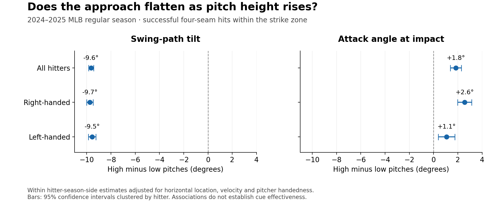

# SwingLab — Approach, Impact & Contact

An independent baseball analysis project by Pat Burgess, built from questions discussed during his time working in professional baseball: how do pitch location, the approach to the ball, and the instant of contact relate?

[Open the live dashboard](https://swing-location-lab-pat.pburgess09.chatgpt.site)

## What the new analysis shows

On successful four-seam hits in the 2024–2025 regular seasons, hitters used a substantially flatter swing plane on higher pitches while retaining a modestly upward attack angle at contact. The approach plane and the direction at impact are different measurements.

| Within-hitter high-minus-low comparison | Difference | 95% confidence interval |
|---|---:|---:|
| Swing-path tilt | -9.64° (flatter) | -9.84° to -9.43° |
| Attack angle at impact | +1.84° (more upward) | +1.38° to +2.29° |

The complete-angle cohort contains 17,660 hits from 705 hitters. The primary adjusted comparison uses 17,384 hits from 625 hitters with within-unit pitch-height variation and available controls. It accounts for horizontal location, pitch velocity, pitcher handedness and separate baselines for each hitter-season-batting-side group. Uncertainty is clustered by hitter.

Attack angle changed less than swing-plane tilt; it was not identical. These are observational associations among successful hits. They do not establish optimal technique, the cause of an individual's movement, or the effectiveness of a “swing down” cue. Cue reports and unsuccessful attempts would be needed to evaluate coaching effects.



## Explore and reproduce

- [Full analysis, definitions, quality checks and sensitivity results](analysis/README.md)
- [Reproducible analysis script](analysis/analyze.py)
- [Analysis input fields: 24,224 source records](analysis/raw/statcast_analysis_fields.csv.gz)
- [Within-hitter estimates and confidence intervals](analysis/output/within_hitter_results.csv)
- [Observed medians by pitch height and batting side](analysis/output/height_summaries.csv)
- [Dashboard source](contact-atlas/)
- [Original Contact Atlas methods](CONTACT-ATLAS.md)

```sh
python -m pip install -r analysis/requirements.txt
python analysis/analyze.py
python scripts/build_swing_plane_dashboard.py
python -m http.server 8000 --directory contact-atlas
```

Open http://localhost:8000. The dashboard is buildless HTML, CSS and JavaScript. Its new analysis includes all/right/left batting-side controls, equal-scale charts, exact tables, uncertainty, cohort notes and downloads. The original rotatable contact-depth atlas remains available below it.

## Keep the two cohorts separate

The original atlas contains 17,963 depth-eligible hits from an earlier imported 2024–2025 dataset. Its width/height coordinates are measured at the plate, while depth is relative to hitter center of mass. It is a statistical graph, not reconstructed contact coordinates or a barrel trajectory.

The new study uses fresh regular-season exports and requires both swing-path tilt and attack angle; contact depth is optional in the primary model. The different counts are intentional. See the notes for missingness and eligibility.

## Source

MLB Statcast / Baseball Savant: [CSV definitions](https://baseballsavant.mlb.com/csv-docs), [swing-path tilt](https://www.mlb.com/glossary/statcast/swing-path-tilt), [attack angle](https://www.mlb.com/glossary/statcast/attack-angle).

Input files retain only fields used by this analysis; unused export columns were removed. Source records and derived results remain subject to provider terms. This independent project is not endorsed by MLB or the University of Miami.
